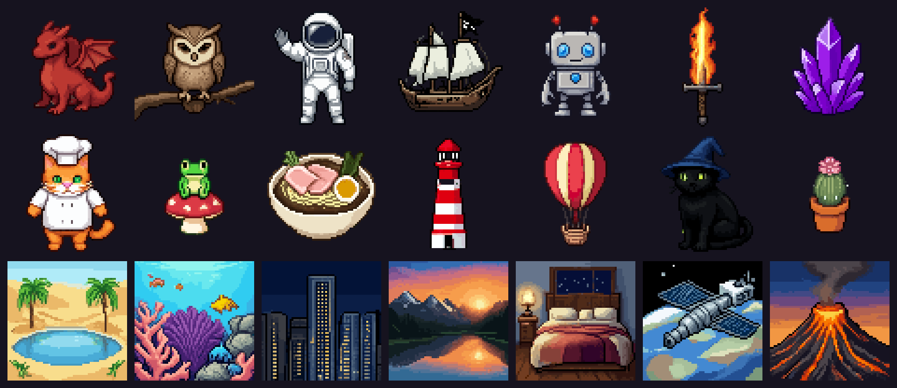

# RD Flow 64

**A 271M-parameter text-to-image model that draws real 64 x 64 pixel art.** No upscaling and no downscaling:
every image is drawn pixel by pixel on the 64 x 64 grid, together with its own palette, and with real transparency.

[**Try it free in your browser**](https://retrodiffusion.ai/rd-flow#demo) ·
[Weights on Hugging Face](https://huggingface.co/Retro-Diffusion/rd-flow-64) ·
[Technical report](https://retrodiffusion.ai/blog/rd-flow-64-technical-report) ·
[Retro Diffusion](https://retrodiffusion.ai)



RD Flow 64 is made by [Retro Diffusion](https://retrodiffusion.ai), to show how much a small, purpose-built image model
can do. The drawing model is a 542 MB file: smaller than most games' install size, about 44x smaller than FLUX.1 and 3x
smaller than Stable Diffusion 1.5. It runs on a laptop.

This repository is the inference code for Windows, Linux and macOS, plus a guide to prompting it.

## What runs where

RD Flow 64 has two parts:

| Part | Size | Job |
| --- | --- | --- |
| Prompt reader (the first 27 layers of [Qwen3-VL-4B-Instruct](https://huggingface.co/Qwen/Qwen3-VL-4B-Instruct)) | 3.1B parameters, 6.2 GB | reads your caption once per prompt |
| Drawing model (RD Flow 64) | 271M parameters, 542 MB | draws the images, 16 steps |

The prompt reader runs once per prompt, so it is fine on the CPU. The drawing model is the part that benefits from a
GPU, and it needs very little VRAM. By default the code puts the prompt reader on the CPU unless your GPU has 10 GB or
more, and the drawing model on your GPU if you have one.

Measured with 4 images per prompt, at the default 16 steps. Reading the prompt happens once per caption: asking for
more images of the same caption costs only the drawing.

| Machine | Placement | Read the prompt | Draw 4 images | Peak memory |
| --- | --- | --- | --- | --- |
| RTX 4090 | everything on the GPU | 0.03 s | 0.7 s | 6.6 GB VRAM |
| PC with a 2 GB GPU (bf16, RTX 20 series or newer) | prompt on CPU, drawing on GPU | 19 s | 0.8 s | 0.8 GB VRAM, 7 GB RAM |
| PC with a 2 GB GPU (GTX 10 series, fp32) | prompt on CPU, drawing on GPU | 19 s | 1.4 s | 1.5 GB VRAM, 7 GB RAM |
| Mac mini M2, 8 GB | prompt on CPU, drawing on the Apple GPU | 20 s | 25 s | 3.3 GB RAM |
| Mac mini M2, 8 GB | everything on the CPU | 21 s | 67 s | 5.0 GB RAM |
| 10 cores of a Xeon Gold 6342, no GPU | everything on the CPU | 19 s | 95 s | 7.6 GB RAM |

The 2 GB rows were measured on a larger GPU capped to 2 GB of VRAM. Most of the RAM is the prompt reader, which is
memory-mapped from its files, so on a machine with less RAM the system pages it instead of running out (the 8 GB Mac
peaks at 3.3 GB).

Both download once from the [Hugging Face repo](https://huggingface.co/Retro-Diffusion/rd-flow-64), about 6.8 GB in total: the
prompt reader ships there with only the layers RD Flow 64 uses.

## Install

You need Python 3.10 to 3.13 and about 8 GB of free disk space.

### Windows

```bat
git clone https://github.com/Retro-Diffusion/rd-flow-64
cd rd-flow-64
python -m venv .venv
.venv\Scripts\activate
:: NVIDIA GPU, RTX 20 series or newer:
pip install torch --index-url https://download.pytorch.org/whl/cu128
:: NVIDIA GTX 10 series (Pascal):
:: pip install torch --index-url https://download.pytorch.org/whl/cu126
:: or no NVIDIA GPU:
:: pip install torch
pip install -r requirements.txt
```

### Linux

```bash
git clone https://github.com/Retro-Diffusion/rd-flow-64
cd rd-flow-64
python3 -m venv .venv
source .venv/bin/activate
# NVIDIA GPU, RTX 20 series or newer (GTX 10 series: use .../whl/cu126):
pip install torch --index-url https://download.pytorch.org/whl/cu128
# or CPU only:
# pip install torch --index-url https://download.pytorch.org/whl/cpu
pip install -r requirements.txt
```

### macOS (Apple Silicon)

```bash
git clone https://github.com/Retro-Diffusion/rd-flow-64
cd rd-flow-64
python3 -m venv .venv
source .venv/bin/activate
pip install torch
pip install -r requirements.txt
```

The drawing model runs on the Apple GPU (MPS) automatically.

## Generate

```bash
python generate.py "A small red health potion in a round glass flask with a cork stopper. ..."
```

The first run downloads the weights. Images go to `outputs/`: the 64 x 64 PNGs, an 8x nearest-neighbour copy of each
for viewing, and the caption as a `.txt`.

Leave out the prompt for an interactive session that loads the model once and keeps asking:

```bash
python generate.py
```

### Write the caption, or have an LLM write it

RD Flow 64 was trained on long, plain descriptions of each picture (120-200 words), and it draws best from a caption
written that way. "red potion" works, but a full caption works much better. Two ways to get one:

- **Write it yourself.** [PROMPTING.md](PROMPTING.md) has the structure, do's and don'ts, and worked examples.
- **Let an LLM write it** with `--expand`. Any OpenAI-compatible chat API works, local or hosted:

```bash
# local, with Ollama (https://ollama.com): ollama pull qwen3:8b
set RDFLOW_LLM_MODEL=qwen3:8b            # Windows (Linux/macOS: export RDFLOW_LLM_MODEL=qwen3:8b)
python generate.py "red potion" --expand

# or hosted, with OpenRouter
set OPENROUTER_API_KEY=sk-or-...
python generate.py "red potion" --expand
```

| Variable | Default |
| --- | --- |
| `RDFLOW_LLM_BASE_URL` | OpenRouter if `OPENROUTER_API_KEY` is set, else Ollama at `http://localhost:11434/v1` |
| `RDFLOW_LLM_MODEL` | `deepseek/deepseek-v4.1-flash` on OpenRouter |
| `RDFLOW_LLM_API_KEY` | `OPENROUTER_API_KEY` |

The system prompt it uses is in [PROMPTING.md](PROMPTING.md#recommended-system-prompt-for-an-llm) and
[`rdflow/prompting.py`](rdflow/prompting.py), ready to paste into any chat model.

### Options

| Option | Default | |
| --- | --- | --- |
| `--n` | 4 | images per prompt |
| `--seed` | random | first seed; image *i* uses seed + *i* |
| `--opaque` | off | a full-frame picture instead of a transparent sprite |
| `--palette` | none | lock every pixel to your colours: `"#1a1c2c,#5d275d,..."` or a `.hex`, `.gpl`, `.pal` or `.txt` file |
| `--steps` | 16 | sampling steps; more gives the same images |
| `--guidance` | 4 | 3-4 is best; higher swells subjects and flattens colour |
| `--expand` | off | have an LLM write the caption |
| `--text-device` | auto | `cpu`, `cuda` or `mps` for the prompt reader |
| `--model-device` | auto | `cpu`, `cuda` or `mps` for the drawing model |
| `--precision` | auto | `bf16` or `fp32` for the drawing model (auto: bf16 if your GPU has it, else fp32) |
| `--weights` | download | a local `rd-flow-64.safetensors` |
| `--compile` | off | `torch.compile` the drawing model (Linux + CUDA; slow first call, faster after) |

### Python

```python
from rdflow import Pipeline

pipe = Pipeline.load()                        # placement chosen for this machine
images = pipe(caption, n=4, seed=1)           # list of 64 x 64 RGBA PIL images
images = pipe(caption, transparent=False)     # a full-frame picture
images = pipe(caption, palette=["#1a1c2c", "#5d275d", "#b13e53", "#ef7d57", "#ffcd75"])
print(pipe.timings)                           # {"prompt_s": ..., "draw_s": ..., "seeds": [...]}
```

## Low-memory tips

- **8 GB of RAM:** it works. On the CPU the prompt reader is memory-mapped straight from its files, so the system can page it out instead of running out of memory; an 8 GB M2 peaks at 3.3 GB with drawing on the Apple GPU.
- **A small GPU (2 GB):** the defaults already keep the prompt reader on the CPU; the drawing model needs
  0.8 GB of VRAM for 4 images in bf16, or 1.5 GB in fp32 on GTX 10 series cards.
- **No GPU:** everything runs on the CPU. Reading the prompt takes about 20 s; drawing 4 images takes
  about a minute on an 8 GB M2 (measured: 67 s).
- Prompts are read once: generating more images of the same caption costs only the drawing.

## How it works

RD Flow 64 is an hourglass flow transformer that works directly on the 64 x 64 pixel grid, with a 16 x 16 core that
attends jointly over the caption, the palette and the image. It generates its own palette as it draws, and late in
sampling every pixel becomes a pointer to one palette entry, so there are never in-between colours.

The [technical report](https://retrodiffusion.ai/blog/rd-flow-64-technical-report) explains how it is built and why: why a pixel art model from scratch, the architecture and
palette, the data, the two choices that made the biggest difference (long captions and the right guidance), and how
it compares with general image models.

## What it is good at

RD Flow 64 draws single subjects and small scenes at 64 x 64: items, characters, creatures, props, buildings, icons and
little landscapes, as transparent sprites or full-frame pictures. Every image comes with its own palette (on average
about 37 colours), and `--palette` locks it to yours.

It is a small model, so it has limits: text and lettering are out of reach, and crowded scenes lose detail.

## Want more?

[Retro Diffusion](https://retrodiffusion.ai) is a full pixel art studio built on larger models: any size from 16 to 512
pixels, dozens of styles, animation, tilesets, editing, background removal and 3D, in the browser or through the API.
[Try RD Flow 64 there for free](https://retrodiffusion.ai/rd-flow#demo).

## License

The code in this repository is MIT licensed. The RD Flow 64 weights are licensed under
[CC BY-NC 4.0](https://creativecommons.org/licenses/by-nc/4.0/) (non-commercial use with attribution). The prompt
reader is part of Qwen3-VL-4B-Instruct by the Qwen team, under the Apache 2.0 license.
